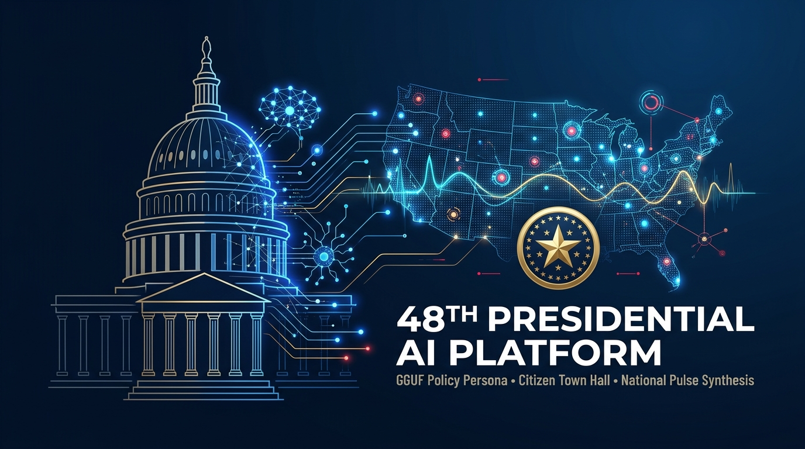

<p align="center">
  
</p>

# 🏛️ 48th Presidential AI Persona & Civic Pulse Platform

An open, zero-hallucination civic artificial intelligence platform designed for the **Candidate for the 48th President of the United States**.

Every citizen across the country can hold direct, multi-turn conversations with the candidate's digital persona—grounded strictly in verified policy stances—while constituent sentiment, popular consensus, and emerging grassroots outliers are automatically anonymized and synthesized into foundational executive documentation (**"The Candidate's Pulse Report"**).

---

## Key Capabilities

1. **Interactive Civic Town Hall Web UI (`ui/`)**:
   - **Citizen Town Hall:** Multi-turn conversational interface with state-by-state localization, suggested prompt chips, Markdown message rendering, PII redaction badges, and a **Live Grounding & Telemetry Inspector** sidebar.
   - **Official Policy Platform Explorer:** Searchable policy cards displaying summaries, operational pillars, and strict candidate veto redlines, with one-click deep dives into chat.
   - **National Pulse & Outlier Synthesis Dashboard:** Real-time KPI metrics, category volume bars, emotional climate breakdowns, an Advisory Council Outlier Queue, and one-click Markdown Executive Briefing generation & download.

2. **Stateful Multi-Turn Conversational Engine (`core/conversation_engine.py`, `core/llm_client.py`)**:
   - Handles natural greetings, platform overviews, identity/architecture inquiries, grounded policy questions, and contextual follow-ups (*"What are your redlines?"*, *"Tell me more about how that works"*).
   - **GGUF Inference Ready:** Automatically routes multi-turn conversations to a local `llama-server` (`llama.cpp` / `vLLM`) running quantized `.gguf` weights (e.g., `Llama-3.1-70B-Instruct-Q4_K_M` or `Llama-3.1-8B-Instruct-Q4_K_M`) when online, and seamlessly runs a built-in stateful persona engine out of the box with zero external dependencies.

3. **Zero-Fabrication Policy RAG & Guardrails (`core/rag_engine.py`, `core/persona_prompt.py`)**:
   - BM25 retrieval with inverse document frequency weighting over [`data/policy_dataset.json`](data/policy_dataset.json).
   - When a citizen raises an unaddressed issue, the persona refuses to invent off-the-cuff promises, explains governing principles, and flags the inquiry for the **National Policy Advisory Council**.

4. **Deterministic PII Privacy Shield (`core/pii_scrubber.py`)**:
   - Automatically scrubs phone numbers, street addresses, emails, SSNs, credit cards, and ZIP codes prior to telemetry logging.

5. **Outlier & Consensus Synthesis (`analytics/`)**:
   - Separates mainstream consensus from statistical outliers and novel grassroots concerns (e.g., agricultural Right-to-Repair, orphan drug foundries, groundwater hydrology, orbital debris) and compiles structured Markdown & JSON briefings.

---

## Project Structure

```text
presidential-ai-platform/
├── assets/
│   └── banner.jpg                       # Repository hero banner
├── api/
│   └── server.py                        # Zero-dependency multi-threaded Web UI & REST API server
├── ui/
│   ├── index.html                       # Mockup UI layout (Town Hall, Platform Explorer, Pulse Dashboard)
│   ├── styles.css                       # Civic theme stylesheet
│   └── app.js                           # Stateful chat client, live RAG inspector & synthesis charts
├── core/
│   ├── conversation_engine.py           # Multi-turn session memory & conversational intent router
│   ├── llm_client.py                    # OpenAI-compatible GGUF llama-server connector
│   ├── persona_prompt.py                # Presidential tone & zero-hallucination system guardrails
│   ├── pii_scrubber.py                  # Deterministic citizen PII redaction filter
│   └── rag_engine.py                    # BM25 policy grounding & retrieval engine
├── analytics/
│   ├── outlier_detector.py              # Mainstream vs. emergent frontier classifier
│   ├── sentiment_analyzer.py            # Emotional valence & urgency analyzer
│   └── synthesis_generator.py           # Executive Pulse Report generator (Markdown & JSON)
├── data/
│   ├── policy_dataset.json              # Verified 6-pillar presidential platform & veto redlines
│   └── sample_citizen_interactions.json # National sample dataset (mainstream + outlier signals)
├── reports/
│   └── sample_pulse_briefing.md         # Example synthesized Executive Pulse Report
├── scripts/
│   ├── run_demo_synthesis.py            # CLI end-to-end conversation & synthesis demo
│   └── setup_gguf_model.sh              # Helper guide to download & serve GGUF weights via llama-server
└── tests/
    └── test_platform.py                 # Automated unit test suite
```

---

## Quickstart

Requires **Python 3.10+** (zero third-party packages required to launch the Web UI and built-in conversational engine).

### 1. Launch the Interactive Mockup UI & Server

```bash
python3 api/server.py --port 8000
```

Open **`http://127.0.0.1:8000`** in your browser to chat with the Presidential AI Persona, inspect live RAG grounding & PII scrubbing, browse the platform planks, and synthesize Executive Pulse Reports.

### 2. Run the CLI Demo & Unit Tests

```bash
# Run end-to-end conversation & briefing synthesis demo
python3 scripts/run_demo_synthesis.py

# Run automated unit tests
python3 -m unittest discover -s tests -v
```

### 3. Connect a Quantized GGUF Model (Optional)

To switch from the built-in persona responder to live neural inference with `llama.cpp`:

```bash
./scripts/setup_gguf_model.sh

llama-server \
  --model ~/models/Meta-Llama-3.1-8B-Instruct-Q4_K_M.gguf \
  --ctx-size 8192 \
  --parallel 8 \
  --port 8080
```

Once `llama-server` is listening on `127.0.0.1:8080`, `api/server.py` automatically detects it and switches the UI badge to **`GGUF Live Server`**.
